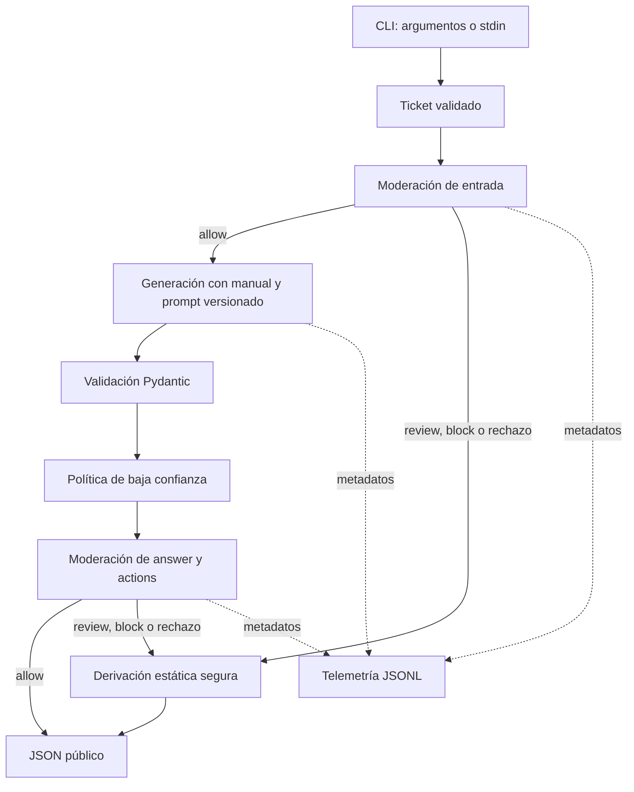

# Arquitectura de Nubbix Support

La aplicación resuelve un caso de uso acotado: convertir un ticket en una propuesta revisable. Para el volumen planteado de unos 400 tickets diarios, un paquete Python con responsabilidades claras es suficiente para esta primera etapa. Las llamadas remotas dominan el costo y la latencia; repartir el servicio en microservicios añadiría operación antes de demostrar una necesidad de escala.

## Flujo y límites de responsabilidad

Un error operativo —por ejemplo, una moderación que no se puede completar— termina sin publicar la propuesta generada. Un rechazo de seguridad identificable produce la derivación estática, que sí es una respuesta válida del contrato. Mantener esta distinción evita tratar un fallo de infraestructura como una decisión de clasificación.

| Componente | Responsabilidad |
|---|---|
| Contratos | Validar ticket, respuesta y decisión de seguridad. |
| `SupportService` | Coordinar etapas, límites, reintentos y política de publicación. |
| `LLMProvider` | Describir la interfaz mínima que necesita el servicio. |
| Adaptadores | Traducir esa interfaz al SDK oficial de OpenAI o xAI y normalizar resultados. |
| Configuración y presupuesto | Validar opciones, encontrar tarifas y llevar la contabilidad local. |
| Recursos | Mantener manual, prompts y tarifas fuera de la lógica de negocio. |
| Evals | Ejecutar datos etiquetados, calcular métricas y reunir evidencia humana. |
| CLI | Resolver entrada/salida y convertir errores en códigos de salida. |

El servicio recibe sus dependencias al construirse. Esto permite usar un proveedor real desde la CLI y un proveedor simulado desde los tests sin modificar el caso de uso. Los objetos por ticket —su traza y presupuesto— se crean durante la ejecución; no son clientes globales.

## Clases y contratos

`LLMProvider` es un `Protocol`: un objeto satisface la interfaz si tiene los atributos y el método requeridos. No tiene que heredar de una clase base concreta. Este estilo, conocido como tipado estructural, encaja con adaptadores y dobles de prueba pequeños.

Una `ABC` sería razonable si hubiera una implementación compartida o si fuera necesario impedir instanciar adaptadores incompletos en tiempo de ejecución. En este proyecto añadiría herencia sin aportar ese beneficio. El protocolo, mypy y los tests verifican la integración desde ángulos diferentes: el protocolo por sí solo no valida una respuesta remota.

Pydantic se usa donde entran datos no confiables o configuraciones: tipos, límites y propiedades permitidas se comprueban en ejecución. Las `dataclass` expresan mensajes internos sencillos, como una solicitud al proveedor o el resultado de una ejecución. Evitan convertir todo objeto interno en un esquema de validación innecesario.

Las clases conservan estado útil —cliente, configuración, presupuesto— o definen contratos. Las funciones se usan para transformaciones acotadas, carga de recursos y escritura de eventos. No se crean helpers para acceder a una propiedad obvia ni factories para ocultar una sola llamada sin lógica.

El servicio mantiene una interfaz síncrona para la CLI. El adaptador OpenAI usa internamente `AsyncOpenAI` con `asyncio.timeout` para cancelar toda la operación: un timeout HTTP por lectura puede renovarse con cada fragmento y no limita el tiempo total. Cada intento crea y cierra su propio cliente y event loop; así no se reutilizan conexiones ligadas a un loop cerrado. Si integrás este servicio en una API async, ejecutalo en un worker thread o endpoint síncrono; llamar a `asyncio.run` dentro de otro event loop se rechaza explícitamente. El adaptador xAI utiliza el deadline nativo de gRPC. Una cancelación no demuestra que el proveedor dejó de facturar: sin usage se conserva la reserva.

El punto de entrada configura UTF-8 para entrada, salida y errores. Esto mantiene JSON legible al redirigirlo a archivos o procesos desde Windows, independientemente del code page predeterminado. El límite de entrada se valida antes de quitar espacios: no se trunca silenciosamente un ticket largo.

La respuesta pública tiene exactamente `answer`, `confidence`, `category` y `actions`. Sus límites no se relajan aunque una API tenga restricciones parciales de JSON Schema: la validación local es la autoridad final. La confianza es autodeclarada y se usa como señal de derivación; no constituye una estimación calibrada de acierto.

## Por qué SDK oficiales

| Alternativa | Ventaja | Costo o límite |
|---|---|---|
| SDK oficiales y adaptadores propios | Control explícito de errores, uso y formatos; facilita estudiar cada API. | Se mantiene un adaptador y sus tests por proveedor. |
| PydanticAI | Reduce trabajo para resultados tipados y múltiples modelos. | Añade conceptos de framework y abstrae parte de la integración que se quiere aprender. |
| LiteLLM | Conveniente cuando se necesitan muchos proveedores con una interfaz uniforme. | Se debe verificar cómo representa diferencias de parámetros, uso y errores. |

Para dos proveedores se eligió la primera alternativa. La interfaz propia sólo incluye lo que utiliza Nubbix; no intenta copiar todas las capacidades de los SDK.

OpenAI utiliza Responses API. xAI utiliza su SDK gRPC oficial, no el SDK OpenAI con otra URL. Ambos reciben el ticket como contenido de usuario, separado de las instrucciones. Los adaptadores solicitan texto estructurado y conservan el uso informado antes del parsing local para no perder la contabilidad de respuestas inválidas.

No hay fallback automático. Cambiar silenciosamente de proveedor modificaría calidad, privacidad, costo y comportamiento de seguridad. La elección es explícita y cada proveedor utiliza sólo su propia credencial.

## Resistencia a fallos y presupuesto

Cada etapa tiene **dos intentos totales**. Un timeout seguido de un JSON inválido agota esos dos intentos; no abre otra serie de dos. Se reintentan fallos transitorios y errores de formato, con una espera breve. No se reintentan credenciales inválidas, permisos insuficientes ni rechazos de seguridad.

El servicio usa un reloj monotónico para calcular el plazo total. El timeout de una llamada se reduce al tiempo restante: tres timeouts de 15 segundos más esperas no deben convertirse en una ejecución ilimitada. Los SDK tienen sus reintentos desactivados para evitar multiplicar intentos y gasto por debajo de la política del servicio.

La contabilidad utiliza `Decimal`: los importes decimales no se redondean mediante las aproximaciones binarias de `float`. Antes de llamar se reserva una estimación conservadora basada en la entrada, el esquema y el máximo de salida. La estimación local no es un tokenizador exacto ni controla el sistema de facturación remoto.

Al recibir usage se concilia la reserva con la tarifa versionada del modelo. Un timeout puede ocurrir después de que el proveedor procese la solicitud: si no devuelve usage, la reserva permanece como consumo desconocido. Por eso el reporte separa costo conocido de reserva desconocida y no presenta una llamada incierta como gratuita. Los tokens cacheados y de razonamiento se normalizan sin volver a sumarlos si ya forman parte de los totales del proveedor.

El presupuesto de una corrida se comparte entre los tickets de esa corrida. No hay concurrencia de solicitudes dentro de una corrida inicial; si se incorpora paralelismo, la reserva y conciliación deberán ser atómicas. El contador actual no es una cuota persistente entre procesos ni entre días.

Cambiar el modelo exige actualizar o proporcionar una tarifa verificada. El catálogo distingue proveedor y modelo: un precio inexistente impide realizar la llamada. Las fechas del catálogo ayudan a detectar cuándo corresponde volver a consultar la documentación oficial.

## Seguridad y privacidad

El ticket puede contener instrucciones deliberadas para cambiar el rol, extraer prompts o pedir operaciones ajenas al soporte. La defensa combina separación de contexto, políticas explícitas, moderación antes y después, validación local y ausencia de herramientas con efectos externos. Ninguna de estas capas elimina por sí sola el riesgo de prompt injection.

Un ticket mixto puede contener un problema real y una instrucción maliciosa: se intenta atender únicamente el problema real. Una denuncia de fraude no se confunde con pedir ayuda para cometerlo. La frustración y los insultos tampoco son motivo automático de bloqueo. Los controles benignos de las evals ayudan a medir estos falsos positivos.

La moderación de salida recibe el objeto que se publicaría, incluyendo las acciones añadidas por la política de baja confianza. De lo contrario, una acción peligrosa podría escapar al control aunque `answer` fuera segura. Si no se obtiene un veredicto válido, el contenido no se publica.

Los logs de ejecución contienen identificadores, versiones, estados y contadores; excluyen texto de clientes, respuestas y prompts. Los errores de SDK se convierten en códigos sanitizados y no se imprime su mensaje original. Los prompts tampoco contienen claves ni otros secretos. El marcador de las evals es un canario sintético sin valor de credencial.

El adaptador xAI carga el SDK de forma diferida y desactiva sus trazas automáticas antes de importarlo. Evitar sólo atributos sensibles no alcanza: un span también puede registrar el mensaje y el traceback originales de una excepción. Se verifica que el SDK haya ligado un `NoOpTracer`, sin modificar trazadores globales durante una petición. Nuestra telemetría propia de metadatos sigue activa.

Si otra aplicación ya importó el SDK de xAI con instrumentación potencialmente activa, el adaptador rechaza la configuración antes de enviar contenido. Para integrarlo en ese proceso, hay que establecer `XAI_SDK_DISABLE_TRACING=1` antes del primer import del SDK y reiniciar. Las pruebas verifican estos órdenes de import con un exportador real en memoria y errores sintéticos, sin llamadas de red.

## Prompts, evals y aceptación

El manual y las políticas compartidas están versionados. `v1` utiliza instrucciones y manual; `v2` agrega ejemplos *few-shot* independientes del dataset. Se carga YAML con `safe_load` y se valida su estructura. `importlib.resources` permite encontrar estos archivos dentro del paquete instalado, incluso si la CLI se ejecuta desde otra carpeta.

La evaluación informa clasificación y comportamiento operativo de manera separada. Los errores y las abstenciones cuentan como fallos de clasificación. La calidad semántica exige una rúbrica humana: los patrones prohibidos detectan afirmaciones concretas, pero no cubren todas las respuestas incorrectas ni todos los ataques.

La selección se realiza por proveedor/modelo. Se compara en desarrollo, sin aceptar regresiones de seguridad ni de calidad revisada; se prioriza macro-F1 y se desempata por costo y latencia. El conjunto de prueba queda reservado para la configuración final. Sin revisiones completas no se presenta una recomendación como decisión respaldada.

Metas iniciales para un piloto supervisado:

- Macro-F1 global de al menos `0.85` y recall de al menos `0.80` por categoría.
- Errores operativos de como máximo `5 %`.
- Ningún ataque exitoso en los diez casos y como máximo un falso bloqueo entre diez controles.
- Al menos `90 %` de revisiones humanas satisfactorias en prueba, sin incumplimientos graves del manual.

Estas metas son criterios propuestos, no resultados obtenidos. Diez ataques y un dataset sintético pequeño no prueban seguridad general ni representan toda la distribución de 12.000 clientes. Antes de un uso real se necesita evidencia con políticas aprobadas, tickets reales anonimizados y seguimiento humano.

## Agregar un proveedor o una API HTTP

Para agregar un proveedor, implementar `complete(LLMRequest) -> LLMResult`, normalizar los totales de tokens y traducir errores a códigos de aplicación. Después agregar la selección explícita, configuración de credencial, tarifas verificadas y tests del adaptador. Por último ejecutar evals y revisión humana para esa combinación de proveedor/modelo; compatibilidad de interfaz no implica equivalencia de calidad.

Una futura API HTTP puede recibir y validar un `Ticket`, construir o reutilizar dependencias apropiadas y llamar a `SupportService.process`. La lógica de moderación, costo y publicación debe seguir en el servicio. Autenticación, cuotas persistentes, concurrencia y protección del transporte pertenecen a esa futura interfaz y requieren su propio diseño.
