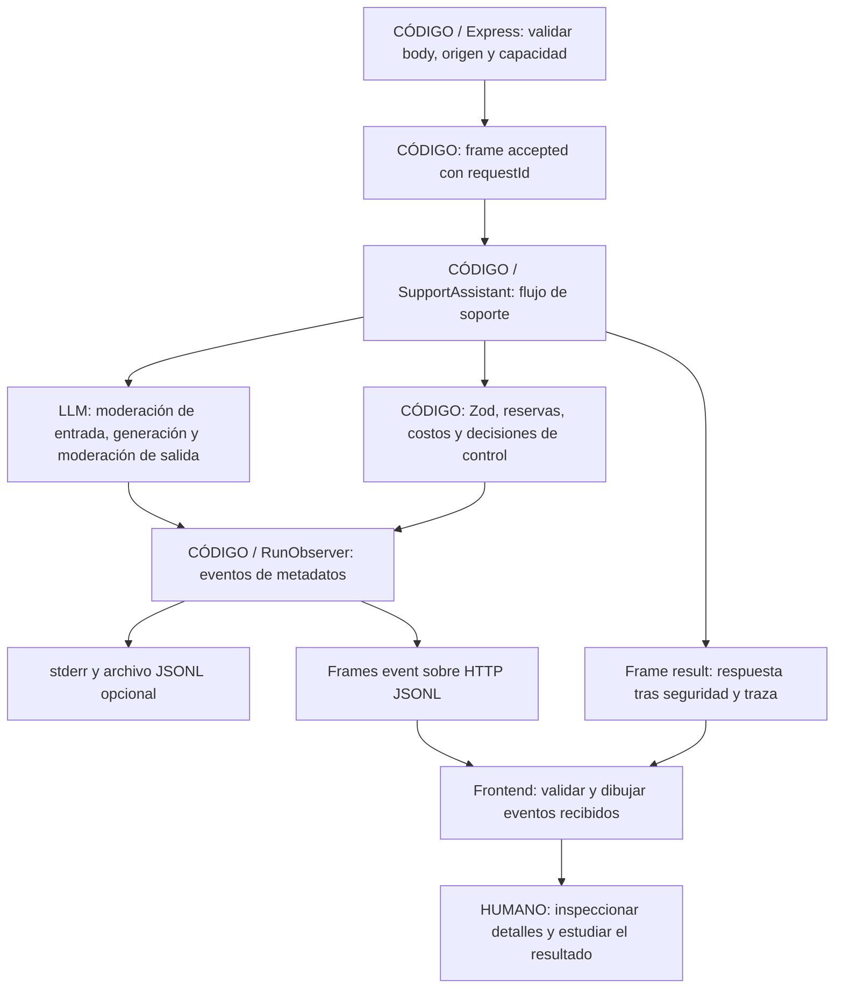

# Seguir una ejecución en vivo

Esta versión agrega una interfaz HTTP local al mismo servicio TypeScript de soporte. Los eventos describen hechos del backend; la pantalla no reconstruye pasos mediante tiempos inventados. No incorpora un LLM juez a las evaluaciones.

## Ejecutar el panel

Desde `typescript-basic`:

```powershell
npm ci
npm run web
```

Abrí http://127.0.0.1:3000. El modo inicial es **DEMO**: no lee claves y no hace llamadas a modelos externos. El proveedor simulado ejecuta el contrato del servicio y espera brevemente para que puedas observar la secuencia. Sus tokens y costos son sintéticos.

Los ejemplos cubren facturación, técnico, cuenta, otros y el bloqueo `DEMO_BLOCK`. En un ticket normal verás tres llamadas al puerto del proveedor; ante bloqueo de entrada, una sola. Los reintentos sólo se muestran si realmente ocurren; el ejemplo demo normal no los provoca artificialmente.

Para ejecutar llamadas reales, configurá las claves en el `.env` de la raíz y arrancá explícitamente:

```powershell
npm run web:live
# O, después de npm run build:
node dist/web/server.js --port 3001 --live --telemetry-file reports/web-events.jsonl
```

Los proveedores sin clave aparecen deshabilitados. Las claves y los clientes SDK quedan en el servidor. Cambiar el selector no envía claves desde el navegador; sólo elige entre adaptadores conocidos. Live consume saldo e incluye moderación y reintentos en los presupuestos existentes.

## Qué significa cada tiempo

| Campo | Significado |
|---|---|
| `timestamp` | Instante UTC en que se construyó el evento. Permite correlacionar registros. |
| `elapsedMs` | Tiempo monotónico transcurrido desde que se creó el observador del servicio. |
| `durationMs` | Duración de la operación indicada; `null` si el evento no representa su finalización. |
| `sequence` | Orden dentro de una única corrida; empieza en 1. |
| Δ en pantalla | Diferencia de `elapsedMs` respecto del evento anterior. No equivale siempre a la duración de una operación. |

`performance.now()` mide duraciones sin depender de ajustes del reloj del sistema. `Date` aporta UTC. El tiempo del servicio no incluye cargar la página o renderizarla. El frame inicial `accepted.receivedAt` identifica cuándo el borde HTTP admitió la solicitud validada, antes de iniciar el servicio; no mide el tiempo previo de red o lectura completa del cuerpo HTTP.

Una duración de request mide el `await` del puerto del proveedor y excluye la emisión posterior del evento. La duración del intento también incluye validación y otros pasos locales; no sumes ambas como si fueran operaciones independientes. El tiempo global incluye las esperas de observabilidad. La espera de un destino está acotada por el deadline, pero cancelar no garantiza que el proveedor no facture trabajo ya realizado.

## Quién hace cada paso



Los actores azules del panel representan operaciones al proveedor; en demo ese proveedor es un doble identificado. Los eventos grises son operaciones locales. `human_review.suggested` sólo informa que se añadió una sugerencia: ninguna persona revisó automáticamente ese ticket.

## Separación de responsabilidades

| Pieza | Responsabilidad y decisión de diseño |
|---|---|
| `SupportAssistant` | Conserva las políticas y el orden del soporte. No conoce Express ni el DOM. |
| `StructuredExecutor` | Mantiene intentos, presupuestos y plazos. Delega instrumentación en colaboradores pequeños. |
| `RunObserver` | Añade identidad, secuencia y relojes; valida metadatos y entrega eventos al sink inyectado. Una instancia por corrida evita mezclar solicitudes. |
| `AttemptObserver` | Rodea una llamada al proveedor y la validación estructurada con eventos. Conserva consumo cuando falla observar una respuesta ya recibida. |
| Funciones de `observability/lifecycle.ts` | Validan entrada y registran intento/cierre; reúnen código repetido, sin crear una jerarquía de clases. |
| `createEventSink` | Escribe metadatos a stderr y archivo. El escritor puede compartirse; cancelar un ticket no aborta el archivo de los demás. |
| `createApp` | Adapta HTTP, aplica límites y conecta el sink de cada request. Se prueba sin abrir el servidor de producción ni leer claves. |
| `HttpEventStream` | Serializa frames, acota su tamaño y espera la escritura para controlar backpressure. |
| `server.ts` | Composition root: configura modelos, prompts, precios y clientes, y abre únicamente loopback. |
| `SupportApi` y `readSupportStream` | Aíslan fetch y el parser JSONL de la presentación. Validan lo recibido con Zod. |
| `TimelineView` | Presenta actores, tiempos, estado y detalles con DOM seguro. No calcula costos ni decide seguridad. |
| `PlaygroundController` | Coordina formulario, cancelación y estado visual. No reproduce las reglas de soporte. |

Esta composición aplica responsabilidad única y dependencias explícitas. Una interfaz sirve cuando hay implementaciones intercambiables, como proveedores o sinks; no se introducen interfaces vacías ni herencia para cumplir una sigla. El frontend usa TypeScript y esbuild: esta pantalla no necesita un framework adicional para gestionar su estado acotado.

## Contrato HTTP e incrementalidad

`GET /api/config` publica modo, proveedores disponibles, modelos, prompts y capacidad. `POST /api/support/stream` acepta exclusivamente:

```json
{"text":"Necesito una factura","provider":"google-ai","promptVersion":"basic-v1"}
```

Un pedido válido devuelve `application/x-ndjson`, con un objeto por línea:

1. `accepted`: identifica la corrida y el modo.
2. `event`: contiene un `FlowEvent` validado. Puede haber múltiples eventos mientras la request sigue abierta.
3. Un único `result` o `error` terminal. El resultado contiene respuesta pública y traza; no propuestas descartadas.

Antes de abrir el stream, entradas inválidas devuelven JSON con HTTP 400/413/403, o 429 si se alcanzó la concurrencia. Una vez enviados headers 200, un fallo del trabajo se comunica como frame `error`; no es posible cambiar retroactivamente el status HTTP. El cliente exige un terminal válido y EOF: cerrar la conexión sin resultado no equivale a éxito.

Los chunks de red no coinciden necesariamente con líneas ni caracteres UTF-8 completos. El lector conserva fragmentos, valida IDs/secuencia/modalidad, limita líneas a 256 KiB y el stream a 500 frames, y rechaza contenido posterior al terminal. El servidor también limita cada frame a 256 KiB. Ese límite contempla respuestas con varios textos largos y caracteres Unicode: un punto Unicode no equivale necesariamente a un byte. Los límites son defensas de memoria, no sustituyen los límites de tokens del modelo.

## CLI y compatibilidad

```powershell
node dist/cli.js --text "Necesito una factura" --provider google-ai --flow-events --telemetry-file reports/timeline.jsonl
```

Sin `--flow-events`, la CLI conserva sus eventos históricos `llm_attempt` y `run_summary`. Con el flag agrega los eventos finos `schemaVersion: 1`. El servidor emite ambas familias a logs y sólo los eventos finos al timeline. Esto evita cambiar el formato de reportes de evals y sus métricas.

Las evals siguen usando el mismo servicio y pueden inyectar un `observe` como cualquier consumidor, pero esta pantalla ejecuta tickets individuales: todavía no es una interfaz para lanzar o adjudicar datasets completos.

## Alcance y seguridad de la herramienta local

- No expone claves, errores crudos SDK, tickets, prompts ni propuestas sin moderar en los eventos. El único contenido de respuesta aparece en `result` después del flujo de seguridad.
- Usa `textContent`, por lo que HTML dentro de una respuesta se muestra como texto. No interpreta Markdown/HTML generado por el modelo.
- Escucha en 127.0.0.1, exige Host local y Origin compatible, aplica CSP y rechaza cuerpos grandes. No habilita CORS.
- Admite cuatro ejecuciones simultáneas por proceso y responde 429 al resto. No hay cola ilimitada ni un limitador de gasto global compartido entre todos los usuarios.
- Cada request conserva sus eventos, presupuesto y señal. Cerrar/cancelar una no cancela las otras. Un navegador lento puede abortar su ejecución al agotar la espera de escritura; no retiene indefinidamente el servicio.
- El panel no archiva contenido automáticamente ni tiene historial/reconexión con replay. Recargar pierde la vista actual. Los logs opcionales contienen metadatos.
- Es un laboratorio local, sin autenticación multiusuario ni infraestructura de despliegue. Publicarlo requeriría decisiones adicionales de autenticación, TLS, cuotas globales y almacenamiento con acceso controlado.

Las pruebas offline y el modo demo validan ingeniería del flujo; no acreditan calidad de respuestas reales, resistencia general a ataques ni capacidad medida de requests por segundo.
