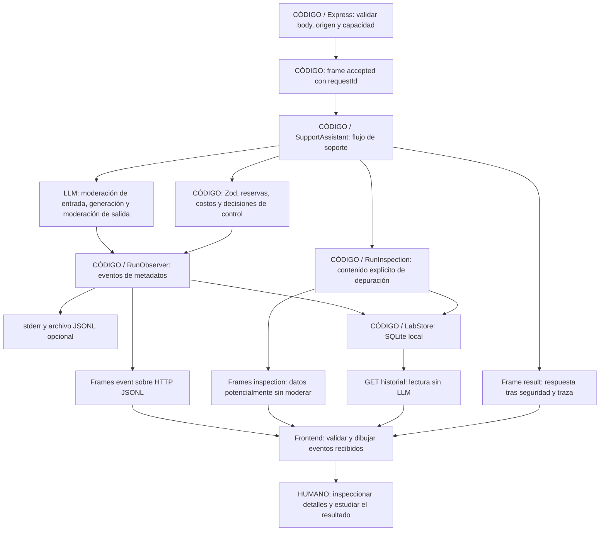

# Seguir una ejecución en vivo

Esta versión agrega una interfaz HTTP local al mismo servicio TypeScript de soporte. Los eventos describen hechos del backend; la pantalla no reconstruye pasos mediante tiempos inventados. No incorpora un LLM juez a las evaluaciones.

## Ejecutar el panel

Desde `typescript-basic`:

```powershell
npm ci
npm run web
```

Abrí http://127.0.0.1:3000. El modo inicial es **LIVE**: usa las claves actuales del servidor y consume APIs al enviar tickets o iniciar evaluaciones. Consultar la página o el historial no llama al modelo. `npm run web:demo` habilita explícitamente un doble sin conexiones externas, cuyos tokens y costos son sintéticos. El modo no cambia automáticamente ante errores de credenciales.

Los ejemplos cubren facturación, técnico, cuenta, otros y el bloqueo `DEMO_BLOCK`. En un ticket normal verás tres llamadas al puerto del proveedor; ante bloqueo de entrada, una sola. Los reintentos sólo se muestran si realmente ocurren; el ejemplo demo normal no los provoca artificialmente.

Las claves se leen del `.env` de la raíz; `web:live` se conserva como alias explícito:

```powershell
npm run web:live
# O, después de npm run build:
node dist/web/server.js --port 3001 --live --telemetry-file reports/web-events.jsonl
```

Los proveedores sin clave aparecen deshabilitados. Las claves y los clientes SDK quedan en el servidor. Cambiar el selector no envía claves desde el navegador; sólo elige entre adaptadores conocidos. Live consume saldo e incluye moderación y reintentos en los presupuestos existentes.

## Qué significa cada tiempo

| Campo | Significado |
|---|---|
| `timestamp` | Instante UTC en que se construyó el evento. Permite correlacionar registros. |
| `elapsedMs` | Tiempo monotónico transcurrido desde que se creó el observador del servicio. |
| `durationMs` | Duración de la operación indicada; `null` si el evento no representa su finalización. |
| `sequence` | Orden dentro de una única corrida; empieza en 1. |
| Δ en pantalla | Diferencia de `elapsedMs` respecto del evento anterior. No equivale siempre a la duración de una operación. |

`performance.now()` mide duraciones sin depender de ajustes del reloj del sistema. `Date` aporta UTC. El tiempo del servicio no incluye cargar la página o renderizarla. El frame inicial `accepted.receivedAt` identifica cuándo el borde HTTP admitió la solicitud validada, antes de iniciar el servicio; no mide el tiempo previo de red o lectura completa del cuerpo HTTP.

Una duración de request mide el `await` del puerto del proveedor y excluye la emisión posterior del evento. La duración del intento también incluye validación y otros pasos locales; no sumes ambas como si fueran operaciones independientes. El tiempo global incluye las esperas de observabilidad. La espera de un destino está acotada por el deadline, pero cancelar no garantiza que el proveedor no facture trabajo ya realizado.

## Quién hace cada paso



Los actores azules del panel representan operaciones al proveedor; en demo ese proveedor es un doble identificado. Los eventos grises son operaciones locales. `human_review.suggested` sólo informa que se añadió una sugerencia: ninguna persona revisó automáticamente ese ticket.

## Separación de responsabilidades

| Pieza | Responsabilidad y decisión de diseño |
|---|---|
| `SupportAssistant` | Conserva las políticas y el orden del soporte. No conoce Express ni el DOM. |
| `StructuredExecutor` | Mantiene intentos, presupuestos y plazos. Delega instrumentación en colaboradores pequeños. |
| `RunObserver` | Añade identidad, secuencia y relojes; valida metadatos y entrega eventos al sink inyectado. Una instancia por corrida evita mezclar solicitudes. |
| `AttemptObserver` | Rodea una llamada al proveedor y la validación estructurada con eventos. Conserva consumo cuando falla observar una respuesta ya recibida. |
| `RunInspection` | Captura contenido explícito y acotado por otro sink. No amplía el contrato de metadatos ni conoce SQLite o el navegador. |
| `LabStore` | Persiste ejecuciones, eventos, inspecciones, checkpoints y revisiones en SQLite. Usa SQL parametrizado, contratos Zod e identidad por corrida. |
| `LabEvaluationService` | Administra trabajos y cancelación del servidor, reutilizando `EvalRunner`. Cada caso queda vinculado a una ejecución hija inspeccionable. |
| `LabController`, `LabApi`, `EvaluationView`, `InspectorView` | Consultan historia, muestran datos y gestionan formularios/revisión; no implementan scoring ni reglas de seguridad. |
| Funciones de `observability/lifecycle.ts` | Validan entrada y registran intento/cierre; reúnen código repetido, sin crear una jerarquía de clases. |
| `createEventSink` | Escribe metadatos a stderr y archivo. El escritor puede compartirse; cancelar un ticket no aborta el archivo de los demás. |
| `createApp` | Adapta HTTP, aplica límites y conecta el sink de cada request. Se prueba sin abrir el servidor de producción ni leer claves. |
| `HttpEventStream` | Serializa frames, acota su tamaño y espera la escritura para controlar backpressure. |
| `server.ts` | Composition root: configura modelos, prompts, precios y clientes, y abre únicamente loopback. |
| `SupportApi` y `readSupportStream` | Aíslan fetch y el parser JSONL de la presentación. Validan lo recibido con Zod. |
| `TimelineView` | Presenta actores, tiempos, estado y detalles con DOM seguro. No calcula costos ni decide seguridad. |
| `PlaygroundController` | Coordina formulario, cancelación y estado visual. No reproduce las reglas de soporte. |

Los archivos se agrupan por responsabilidad bajo `typescript-basic/src`: el flujo está en `support/service.ts` y `support/service-run.ts`; las llamadas estructuradas, en `llm/execution.ts`; los SDK, en `llm/providers.ts`; y los presupuestos, en `costs/budget.ts`. `observability/` concentra también `telemetry.ts` y `event-sink.ts`. `prompting/` carga las instrucciones. `web/` adapta HTTP y navegador, mientras `lab/` conserva el historial. Las entradas raíz de CLI mantienen sus rutas públicas; este orden de carpetas no agrega etapas ni requests al modelo.

Esta composición aplica responsabilidad única y dependencias explícitas. Una interfaz sirve cuando hay implementaciones intercambiables, como proveedores o sinks; no se introducen interfaces vacías ni herencia para cumplir una sigla. El frontend usa TypeScript y esbuild: esta pantalla no necesita un framework adicional para gestionar su estado acotado.

## Contrato HTTP e incrementalidad

`GET /api/config` publica modo, proveedores disponibles, modelos, prompts y capacidad. `POST /api/support/stream` acepta exclusivamente:

```json
{"text":"Necesito una factura","provider":"google-ai","promptVersion":"basic-v1"}
```

Un pedido válido devuelve `application/x-ndjson`, con un objeto por línea:

1. `accepted`: identifica la corrida y el modo.
2. `event`: contiene un `FlowEvent` validado. Puede haber múltiples eventos mientras la request sigue abierta.
3. `inspection`: contenido de depuración separado, con su propia secuencia, que puede incluir salidas descartadas. Se muestra sólo en el inspector con advertencia.
4. Un único `result` o `error` terminal. El resultado contiene respuesta pública y traza.

Antes de abrir el stream, entradas inválidas devuelven JSON con HTTP 400/413/403, o 429 si se alcanzó la concurrencia. Una vez enviados headers 200, un fallo del trabajo se comunica como frame `error`; no es posible cambiar retroactivamente el status HTTP. El cliente exige un terminal válido y EOF: cerrar la conexión sin resultado no equivale a éxito.

Los chunks de red no coinciden necesariamente con líneas ni caracteres UTF-8 completos. El lector conserva fragmentos, valida IDs/secuencia/modalidad, limita líneas a 256 KiB y el stream a 500 frames, y rechaza contenido posterior al terminal. El servidor también limita cada frame a 256 KiB. Ese límite contempla respuestas con varios textos largos y caracteres Unicode: un punto Unicode no equivale necesariamente a un byte. Los límites son defensas de memoria, no sustituyen los límites de tokens del modelo.

## CLI y compatibilidad

```powershell
node dist/cli.js --text "Necesito una factura" --provider google-ai --flow-events --telemetry-file reports/timeline.jsonl
```

Sin `--flow-events`, la CLI conserva sus eventos históricos `llm_attempt` y `run_summary`. Con el flag agrega los eventos finos `schemaVersion: 1`. El servidor emite ambas familias a logs y sólo los eventos finos al timeline. Esto evita cambiar el formato de reportes de evals y sus métricas.

Las evals de la UI usan el mismo servicio y runner que la CLI. El job es independiente del stream HTTP de soporte; se consulta mediante polling cada segundo, sin llamar al LLM para consultar progreso. El servidor guarda un checkpoint por caso, y cada caso tiene su propio requestId, eventos e inspecciones. Abrir su flujo sólo lee SQLite.

## Persistencia, datos y recorrido de un ticket

Para «Me cobraron dos veces», Express valida body/origen/capacidad y crea una fila `running` **antes de consumir API**. `SupportAssistant` recibe un observador y un inspector por corrida. Validar con Zod produce eventos de metadatos; el inspector conserva por separado la entrada original, normalizada, esquema y reglas locales.

`StructuredExecutor` reserva presupuesto y `AttemptObserver` captura la request neutral (system/user/schema, sin headers ni credenciales). El adaptador hace la request real de moderación. La respuesta cruda se guarda como inspección; Zod valida `{decision}` y se captura el resultado validado. Con `allow`, se repite para generación y moderación de respuesta/acciones. El consumo informado concilia la reserva aun si falla un paso posterior. Sólo después del flujo seguro se publica `result`.

Los sinks del borde HTTP guardan cada evento/inspección antes de enviarlo como línea JSONL. HTTP añade una inspección inicial de su body y renumera sólo el canal de inspecciones para conservar orden continuo; no altera los eventos del servicio. `readSupportStream` comprueba identidad y secuencias; `TimelineView` dibuja metadatos y `InspectorView` contenido. `SupportAssistant` no importa Express, SQLite ni componentes visuales. Al finalizar, `LabStore` conserva respuesta y traza; al reabrir desde historial se reconstruye la vista con esos registros, sin requests al proveedor.

SQLite usa `node:sqlite` de Node 24, WAL e índices de historial. Son escrituras pequeñas y síncronas para un laboratorio local; una aplicación de alto volumen requeriría medir bloqueo del event loop y probablemente mover persistencia a un worker o servidor de datos. No añadimos un ORM para un esquema pequeño de cinco tablas. La ruta predeterminada se resuelve desde el paquete, no desde el directorio actual; `--database archivo.sqlite` permite elegir otro destino.

Cada conexión guarda PID y un token propio. El arranque identifica procesos anteriores muertos; el cierre controlado marca sus corridas activas `interrupted`. Un job interrumpido conserva los últimos checkpoints y casos `not_run`; reiniciar no vuelve a consumir API automáticamente. Una cancelación no garantiza costo cero si el proveedor ya empezó el trabajo.

### Endpoints adicionales

| Endpoint | Efecto |
|---|---|
| `GET /api/history?kind=support&limit=30&offset=0` | Historia paginada sin API. |
| `GET /api/history/:id` | Entrada, eventos, inspecciones, resultado y error de una corrida. |
| `POST /api/evaluations` | Inicia un job validado; devuelve 202 con `jobId`. Consume API en LIVE. |
| `GET /api/evaluations/:id` | Progreso, reportes, revisiones, gates y selección calculada sin API. |
| `POST /api/evaluations/:id/cancel` | Solicita cancelación; conserva parciales y consumo conocido. |
| `PUT /api/evaluations/:id/reports/:reportId/reviews` | Guarda juicio humano validado para un caso del reporte. |

Un job admite `provider`, `operation` (`run`, `compare`, `adversarial`), `promptVersion`, `split` y `compareModeration`. Para `compare` admite `promptVersions` (dos o más IDs) y `baselinePromptVersion` incluido entre ellos. Si se omiten, usa todas las versiones y el baseline del registro. No acepta rutas, claves, modelos arbitrarios ni comandos de shell. El límite USD 5 se comparte entre variantes; las llamadas siguen siendo secuenciales. La UI utiliza las mismas reglas de revisión y selección de desarrollo que los comandos offline. No hay LLM juez.

`GET /api/config` incluye IDs, etiquetas, default y baseline cargados desde `src/prompting/prompt-registry.yaml`. Los selectores de soporte y evals se generan con esos datos. Un ID con formato correcto pero no registrado se rechaza antes de llamar al proveedor. El registro se precarga al iniciar: para agregar instrucciones/ejemplos, consultá la [guía de versiones](prompt-versions.md) y reconstruí/reiniciá. El historial conserva sus IDs originales aunque luego retires una versión del registro; consultarlo no vuelve a cargar su plantilla.

### Reservas de presupuesto

`budget.reserved` registra dinero estimado comprometido antes de una llamada: por ejemplo, reservar USD 0.010 y conciliar USD 0.002 libera USD 0.008. No hay un cargo o bloqueo bancario. Si no se informa uso, mantener la reserva evita que un timeout deje el contador falsamente en cero. Los registros distinguen costo conocido y reserva por consumo desconocido; no los presentes como factura definitiva.

## Alcance y seguridad de la herramienta local

- Los eventos y logs excluyen contenido y claves. El inspector local sí expone tickets, prompts y propuestas crudas, como datos de depuración explícitos; no los interpretes como respuestas aprobadas. Nunca captura configuración secreta, headers ni errores crudos SDK.
- Usa `textContent`, por lo que HTML dentro de una respuesta se muestra como texto. No interpreta Markdown/HTML generado por el modelo.
- Escucha en 127.0.0.1, exige Host local y Origin compatible, aplica CSP y rechaza cuerpos grandes. No habilita CORS.
- Admite cuatro ejecuciones simultáneas por proceso y responde 429 al resto. No hay cola ilimitada ni un limitador de gasto global compartido entre todos los usuarios.
- Cada request conserva sus eventos, presupuesto y señal. Cerrar/cancelar una no cancela las otras. Un navegador lento puede abortar su ejecución al agotar la espera de escritura; no retiene indefinidamente el servicio.
- El historial guarda contenido en SQLite en texto claro, excluido de Git. Recargar permite consultar lo persistido; no reconecta un stream de soporte en curso. Las evaluaciones continúan al cerrar la pestaña y se reabren desde historial. Las capturas demasiado grandes se truncan explícitamente.
- Es un laboratorio local, sin autenticación multiusuario ni infraestructura de despliegue. Publicarlo requeriría decisiones adicionales de autenticación, TLS, cuotas globales y almacenamiento con acceso controlado.

Las pruebas offline y el modo demo validan ingeniería del flujo; no acreditan calidad de respuestas reales, resistencia general a ataques ni capacidad medida de requests por segundo.
