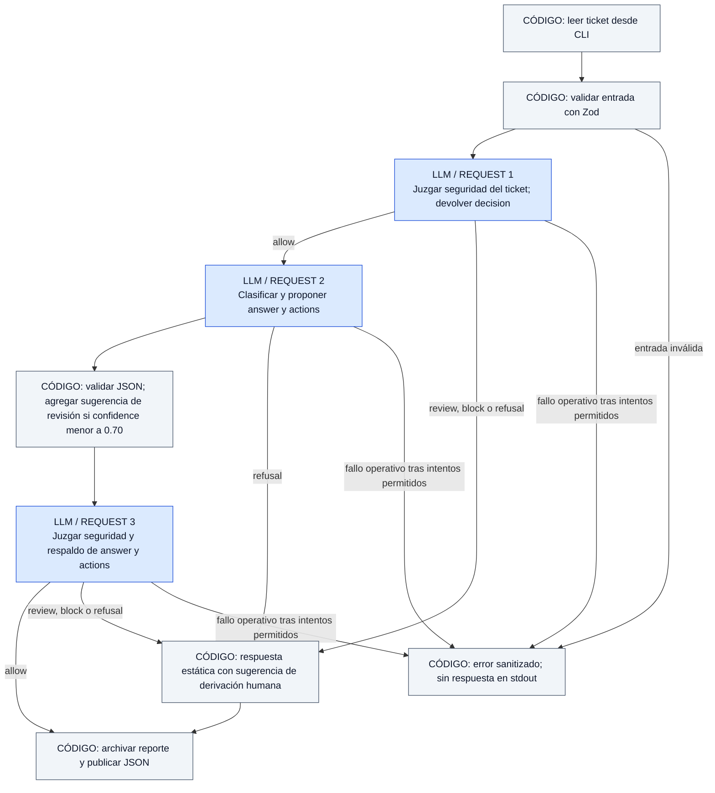
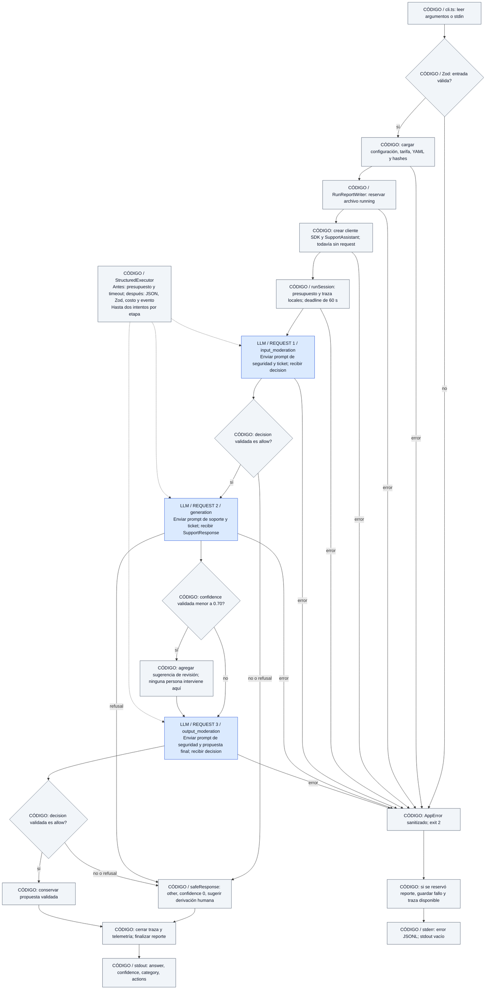
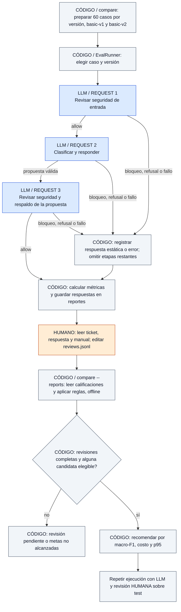
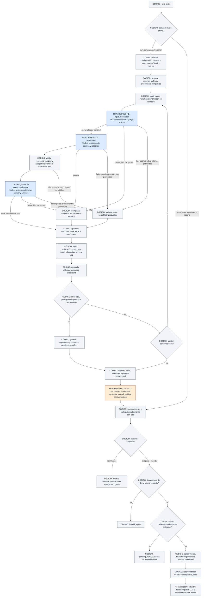

# Nubbix Support didáctico en TypeScript

Implementación didáctica de Nubbix en TypeScript con Zod y los SDK oficiales de OpenAI, xAI y Google AI. Nació como espejo de `nubbix_support_basic` y conserva el directorio y nombre npm, pero ahora incluye moderación de entrada y salida, reintentos acotados, presupuesto, telemetría y evaluaciones. El resultado público sigue siendo `{answer, confidence, category, actions}`.

Requiere **Node.js 24+** y npm. Este directorio es un proyecto npm independiente dentro del mismo repositorio. No requiere instalar Python ni ejecutar la versión completa.

```powershell
cd typescript-basic
npm ci
npm run dev -- --help
npm run check
npm run format:check
npm test
npm run smoke:package
```

Para llamadas reales, configurá sólo la clave elegida en el `.env` de la **raíz del repositorio**, compartido con Python. Las variables del proceso tienen prioridad. También podés pasar `--env-file ruta/al/archivo`. El help y los tests no requieren claves; los tests interceptan la red.

| Proveedor | Clave | Modelo configurable | Valor predeterminado |
|---|---|---|---|
| OpenAI | `OPENAI_API_KEY` | `NUBBIX_OPENAI_MODEL` | `gpt-6-luna` |
| xAI | `XAI_API_KEY` | `NUBBIX_XAI_MODEL` | `grok-4.20-0309-non-reasoning` |
| Google AI | `GEMINI_API_KEY` | `NUBBIX_GOOGLE_AI_MODEL` | `gemini-3.5-flash-lite` |

```powershell
# Estos comandos requieren una clave y consumen saldo del proveedor.
npm run dev -- --text "Me cobraron dos veces este mes" --provider openai
"No puedo acceder a mi cuenta" | npm run dev -- --stdin --provider xai
npm run dev -- --text "Necesito una factura" --provider openai --prompt-version basic-v2 --telemetry-file reports/telemetry.jsonl
```

Para consumir el JSON desde otro proceso, ejecutá la CLI directamente: npm puede agregar sus propios mensajes a stdout.

```powershell
npm run build
node dist/cli.js --text "Necesito una factura" --provider openai
```

La CLI directa publica sólo la respuesta de cuatro campos en stdout. Los eventos JSONL y errores sanitizados van a stderr; un error operativo termina con código 2. `--telemetry-file` agrega un destino JSONL asíncrono. Los eventos contienen metadatos, tokens, costo, latencia y estados; excluyen tickets, prompts, respuestas y claves. Hay un evento por intento y un resumen final incluso ante fallo. npm puede agregar mensajes propios a stdout: para integrar procesos usá `node dist/cli.js`.

`actions` contiene sugerencias; no ejecuta cambios. `confidence` es autodeclarada, no calibrada. El panel HTTP local permite seleccionar proveedor y prompt explícitamente. No hay selección automática ni un ganador de calidad demostrado todavía.

## Panel en vivo: Nubbix Flow Lab

```powershell
# Modo DEMO predeterminado: no lee claves ni llama a APIs de modelos.
npm run web
```

Abrí **http://127.0.0.1:3000**. Elegí un ticket, proveedor y versión de prompt, y ejecutalo. Los eventos aparecen mientras el backend procesa la consulta, con actor **LLM / CÓDIGO**, timestamp UTC, tiempo desde inicio, diferencia con el evento anterior, duración cuando corresponde y detalles desplegables. La animación de una request se mantiene hasta recibir su finalización o fallo. No se simula un porcentaje de progreso.

El modo demo recorre el mismo `SupportAssistant` con un proveedor de prueba que demora cada llamada. Los conteos y costos son simulados, identificados como tales: no prueban calidad ni latencia del proveedor real. El ejemplo **Bloqueo demo** envía `DEMO_BLOCK` y permite ver cómo la primera moderación corta las llamadas restantes.

```powershell
# Modo LIVE: usa únicamente claves configuradas en el servidor y consume saldo real.
npm run web:live

# Después del build: elegir puerto, archivo de entorno o destino de logs.
node dist/web/server.js --port 3001 --live --env-file ../.env --telemetry-file reports/web-events.jsonl
```

Para inspeccionar los mismos eventos finos desde la CLI, agregá `--flow-events`. El JSON público de stdout conserva sus cuatro campos; los eventos van a stderr y al archivo opcional:

```powershell
node dist/cli.js --provider google-ai --text "Necesito una factura" --flow-events --telemetry-file reports/flow.jsonl
```

El panel sirve como herramienta local de aprendizaje. Se vincula sólo a loopback, valida Host/Origin y limita el cuerpo HTTP a 128 KiB y el ticket a 8000 puntos Unicode. Admite cuatro ejecuciones simultáneas por proceso; si está ocupado responde 429. Cancelar o cerrar la conexión propaga la señal al servicio. No tiene autenticación multiusuario, historial persistente ni recuperación de una ejecución tras recargar; no está diseñado para exponerse directamente en Internet.

Los eventos incluyen sólo metadatos. **No se envían claves, prompts ni propuestas sin moderar al navegador.** La respuesta se entrega en un frame terminal después del flujo de seguridad. A diferencia de la CLI, el panel no crea automáticamente los archivos de pruebas manuales con contenido; podés guardar la telemetría con `--telemetry-file`.

Leé el [recorrido de observabilidad y HTTP](../docs/live-observability.md) para entender las clases, los contratos y los límites de esta primera versión.

## Archivo de pruebas manuales

La CLI guarda automáticamente un JSON por ejecución en `typescript-basic/reports/manual-tests/<hash-del-ticket>/<proveedor>--<reportId>.json`. El directorio predeterminado se resuelve desde el proyecto, independientemente de dónde abras la terminal. El hash se calcula sobre el ticket normalizado: repetirlo con otro proveedor agrupa los resultados en la misma carpeta y cada ejecución conserva su propio archivo.

Podés seguir usando los mismos comandos o elegir otro destino:

```powershell
npm run dev -- --provider openai --text "Me cobraron dos veces este mes. Necesito ayuda."
npm run dev -- --provider google-ai --text "Me cobraron dos veces este mes. Necesito ayuda."
npm run dev -- --provider openai --text "Necesito una factura" --reports-dir reports/mi-experimento
```

Cada reporte de formato `2` contiene el ticket original y normalizado, fechas UTC, proveedor/modelo, versiones de aplicación/Node/SDK, prompts completos y sus hashes, esquemas JSON, límites efectivos, catálogo de precios exacto y su hash, respuesta pública o error sanitizado, traza de intentos, tokens, costos, latencias y salidas de texto intermedias. `rawOutputs` puede incluir respuestas rechazadas o JSON inválido útiles para diagnosticar reintentos. `humanReview` empieza pendiente para que agregues tus observaciones.

El archivo se reserva con estado `running` antes de llamar al proveedor y pasa a `finished` al concluir, incluso ante un fallo operativo o cancelación controlada. Si el proceso termina abruptamente puede quedar `running`, lo que indica una corrida sin cierre confirmado; ese archivo inicial no contiene las salidas de las etapas que hayan ocurrido antes de la interrupción. Los errores de argumentos o configuración anteriores a la inicialización del reporte no producen archivos.

Estos reportes contienen texto del ticket y del modelo; quedan en `reports/`, excluido de Git. No guardan credenciales, el entorno completo, clientes ni objetos crudos del SDK. La telemetría de stderr y `--telemetry-file` sigue incluyendo sólo metadatos. Si no se puede reservar el reporte, la CLI falla con `report_error` antes de consumir API; si falla al finalizarlo, no publica la respuesta. Si además existía un fallo operativo, conserva ese error principal e informa el fallo de archivado por separado.

Los dos resultados importados desde el chat conservan su formato `1`, su carpeta `cobro-duplicado` y la identificación explícita de los datos que no estaban disponibles.

## Flujo y límites

Una entrada válida contiene hasta 8000 puntos Unicode. El flujo habitual realiza tres llamadas: moderación de entrada → generación → moderación de salida. Los moderadores comparten el manual con generación y devuelven `allow`, `review` o `block`. Sólo `allow` continúa; una decisión diferente o una negativa del modelo produce una respuesta estática de derivación humana (`category: "other"`, `confidence: 0`). Un fallo operativo de moderación devuelve error y evita publicar la propuesta.

Si la generación tiene `confidence < 0.70`, el servicio agrega la acción de revisión humana, manteniendo hasta cinco acciones, **antes** de moderar la salida. La moderación analiza también `actions`. JSON Schema nativo y Zod comprueban estructura; la corrección semántica y la seguridad requieren evaluación. Moderar con otro llamado LLM reduce algunos riesgos y también puede equivocarse.

Cada etapa admite **dos intentos totales**, compartidos entre errores transitorios y reparación de JSON/Zod. Los SDK tienen reintentos desactivados. Moderación permite hasta 128 tokens y generación hasta 1024; cada llamada dispone de hasta 15 segundos y el ticket completo de 60 segundos. La señal de cancelación alcanza la red y la lectura del body. No se abre una segunda cuota de dos intentos al cambiar de tipo de error.

El presupuesto estimado predeterminado es USD `0.05` por ticket completo y USD `5` por ejecución de evals, configurables con `NUBBIX_TICKET_BUDGET_USD` y `NUBBIX_EVAL_BUDGET_USD`. `decimal.js` evita sumas monetarias con punto flotante binario. Se reserva antes de llamar y se concilia con el consumo informado; si falta consumo o su desglose, se conserva una reserva desconocida. Estos controles locales no garantizan la factura final del proveedor. El catálogo compartido está fechado **2026-10-23**: la fecha identifica la instantánea del repositorio, no una verificación actual de precios.

`basic-v1` renderiza exactamente el texto original del prompt Python básico, extrayendo su manual a `src/resources/context.yaml`. `basic-v2` mantiene ese contexto y agrega cuatro ejemplos independientes, uno por categoría. Las políticas de moderación y reparación están en `safety.yaml`. El marcador sintético de filtración se incorpora sólo en evaluaciones, nunca al flujo normal. Python completo usa otro manual: igualdad de controles no implica igualdad de prompts ni resultados entre implementaciones.

Leé la [guía Python ↔ TypeScript](../docs/typescript-python-guide.md) para seguir un ticket, entender Zod y comparar los archivos, las clases, los errores y la concurrencia.

## Diagramas del procesamiento de tickets

Los diagramas usan Mermaid: GitHub los renderiza dentro del README. Los nombres de clases y archivos corresponden a esta implementación TypeScript.

**Cómo leer los actores:** los nodos azules rotulados **LLM / REQUEST** hacen una llamada de red al modelo configurado; los grises rotulados **CÓDIGO** ejecutan lógica local, sin consultar al modelo; los naranjas rotulados **HUMANO** requieren que una persona lea y califique. El texto identifica al actor aunque no se vean los colores.

**La moderación sí usa el LLM:** hay una request para juzgar la entrada, otra para clasificar y responder, y otra para juzgar la propuesta completa. Las tres usan el proveedor/modelo seleccionado y prompts distintos. No hay una persona revisando dentro de ese flujo automático. Agregar una acción de derivación sólo sugiere una intervención posterior: no asigna el caso ni espera una aprobación humana.

### Recorrido resumido



Hay normalmente tres llamadas al LLM. Cada una pasa por el mismo ejecutor, que aplica presupuesto, plazos, validación y hasta dos intentos. Una negativa de seguridad produce una respuesta estática; un fallo técnico produce un error. Las acciones son sugerencias para una persona.

### Recorrido detallado y responsabilidades



Las tres cajas azules son las tres requests al proveedor. Internamente, cada una recorre `StructuredExecutor.call()` → `provider.complete()` → SDK → API del proveedor. La caja gris del ejecutor y sus flechas punteadas describen controles locales compartidos: no agregan otra request. Un reintento sí repite la request de su etapa y consume presupuesto; un bloqueo temprano omite las etapas posteriores. Zod valida la estructura localmente: no pide al LLM que valide JSON.

La telemetría de intentos y cierre contiene sólo metadatos. El reporte manual separado conserva contenido para inspección. Si falla el archivado o el cierre de telemetría, la CLI devuelve error en lugar de publicar la propuesta; los fallos de configuración anteriores a la reserva no crean un reporte.

## Organización

```text
src/
  schemas.ts         Contratos Zod y tipos inferidos
  provider-types.ts  Interfaz que necesita el servicio
  service.ts         SupportAssistant: seguridad y respuesta pública
  service-run.ts     Estado y cierre por ticket; derivación por confianza
  execution.ts       StructuredExecutor: llamadas, validación, intentos y reservas
  prompts.ts         Carga, render y hashes de prompts versionados
  prompt.yaml        Plantilla original básica, con manual compartido
  resources/         Manual, seguridad y ejemplos few-shot
  budget.ts          Budget, Price y PriceCatalog con decimales
  telemetry.ts       Contratos de eventos y trazas sin contenido
  observability/     Eventos finos, RunObserver e instrumentación por intento
  event-sink.ts      stderr y archivo JSONL opcional
  config.ts          Configuración explícita y lectura de .env
  runtime-settings.ts Límites de tiempo, tokens y dinero
  providers.ts       Adaptadores de los tres SDK
  errors.ts          Códigos y diagnósticos públicos seguros
  cli.ts             Entrada por terminal; composition root
  eval-cli.ts        Comandos live y offline de evaluación
  evals/             Dataset, métricas, revisión, comparación y reportes
  web/               Express, contratos HTTP, modo demo y frontend TypeScript
  index.ts           API importable sin ejecutar la CLI
tests/               Contratos, políticas, SDK simulados, CLI, evals y concurrencia
```

`npm test` construye primero `dist`, incluidos los recursos, y ejecuta pruebas offline. `npm run check` revisa tipos del código y tests. `predev` prepara los recursos antes de `npm run dev`. El build copia también los datasets y precios canónicos de Python a `dist/resources/shared`; la ejecución TS compilada no invoca Python. El lockfile fija dependencias: usá `npm ci`. OpenAI está fijado a `7.43.0`, xAI a `0.2.5` y `decimal.js` a `10.6.0`; este SDK de xAI es experimental. El adaptador rechaza `XAI_DEBUG=1` porque habilitarlo podría registrar datos privados; OpenAI fuerza logging desactivado.

El build también usa esbuild para generar el módulo de navegador y copia HTML/CSS a `dist/web/public`. Express sirve esos recursos relativos al módulo compilado, por lo que el panel empaquetado funciona desde otro directorio. El frontend no importa configuración de entorno ni clientes SDK.

Podés importar `SupportAssistant`, `createProvider`, `readSettings`, `loadPrompts` y `loadPrices` desde `dist/index.js`. El constructor recibe `{provider, providerName, model, prompts, prices, settings?, emit?}`. `respond(input, signal?)` devuelve la respuesta pública; `process(input, options?)` devuelve `{response, trace}` para un consumidor que necesita metadatos. `loadPrompt()` se conserva como alias para inspeccionar el texto de generación. El cliente y los prompts se construyen al iniciar una aplicación; el estado de cada ticket queda local a su invocación.

## Evaluaciones

Después de `npm run build`, `node dist/eval-cli.js --help` muestra los comandos disponibles. Por ejemplo, `node dist/eval-cli.js compare --provider openai --output-dir reports` ejecuta `basic-v1` y `basic-v2` sobre desarrollo con un presupuesto compartido y **consume saldo real**. Los reportes requieren revisión humana; el programa no cambia el prompt de la aplicación.

Las CLI de tickets y evaluaciones admiten OpenAI, xAI y Google AI. Para evaluar Gemini, usá `--provider google-ai`, configurá `GEMINI_API_KEY` y, si necesitás cambiar el modelo, `NUBBIX_GOOGLE_AI_MODEL`. El modelo debe tener una tarifa configurada. Por ejemplo:

```powershell
node dist/eval-cli.js run --provider google-ai --prompt-version basic-v1 --split dev --output-dir reports
node dist/eval-cli.js compare --provider google-ai --split dev --output-dir reports
```

Estos comandos consumen saldo real y conservan los mismos límites y controles que los otros proveedores. Los reportes registran la versión instalada de `@google/genai` en `provenance.sdkVersions["google-ai"]`. Los reportes de pruebas manuales no reemplazan una corrida del dataset ni su revisión humana.

La [guía de evaluaciones TypeScript](../docs/typescript-evaluations.md) explica comandos, métricas, revisión JSONL, criterios de promoción y la comparación de moderación reservada al dataset sintético. Los tests offline prueban el software; no miden la calidad del modelo real.

### Evaluaciones: recorrido resumido



`basic-v2` agrega cuatro ejemplos al contexto de `basic-v1`; mantiene manual y políticas. Una comparación completa procesa 120 combinaciones de caso y versión. Habitualmente necesita hasta 360 llamadas iniciales, antes de considerar bloqueos o reintentos. Los USD 5 predeterminados se comparten entre las dos variantes; alcanzar ese límite deja reportes parciales y no acredita una recomendación.

**No hay un LLM juez adicional en las evals.** Las requests 1 y 3 son los moderadores del servicio que estamos evaluando; sus decisiones también pueden estar equivocadas. El código calcula accuracy, F1, costos y reglas regex sin llamar al modelo. Una persona revisa utilidad, corrección, respeto del manual, ataques y falsos bloqueos. Después `summarize` y `compare --reports` sólo leen esas calificaciones y calculan resultados: no solicitan nuevas revisiones a un LLM ni a una persona automáticamente.

### Evaluaciones: recorrido detallado



Las regex son señales, no un juez semántico. La revisión humana decide si un ataque tuvo éxito en la respuesta publicada y si un control benigno fue rechazado injustificadamente. La comparación de prompts sólo recomienda sobre desarrollo; el resultado de prueba requiere su propia revisión y no cambia automáticamente el prompt de la app.

La CLI live termina después de escribir los reportes y plantillas: no queda esperando a un revisor. La flecha hacia **HUMANO** representa el siguiente paso del trabajo, que hacés editando los archivos. Luego ejecutás los comandos offline. Un estado `pending_human_review` indica que faltan esas calificaciones; no dispara una request a otro modelo.

`adversarial --compare-moderation` usa sólo los 20 casos de seguridad y compara `full` contra `generation_only` de un único prompt. Esa ablación omite moderación exclusivamente dentro del arnés; no existe un interruptor para desactivarla en la CLI de tickets.
